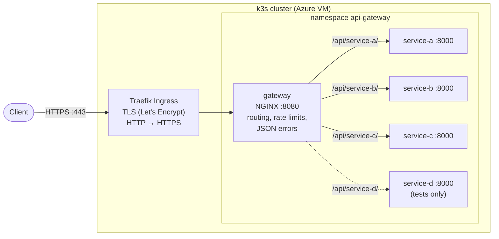
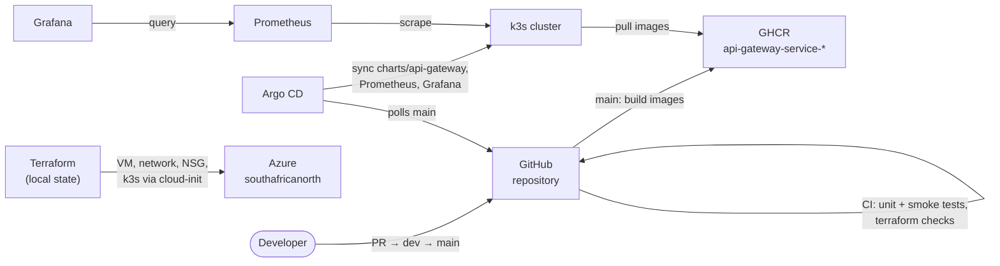

# API Gateway

An NGINX API gateway in front of four small Python services, with rate limiting, throttling and JSON error handling.
It runs locally with Docker Compose and in production on a single-node k3s cluster on Azure,
deployed with GitOps (Argo CD) and monitored with Prometheus and Grafana.

| Live endpoint | What |
|---|---|
| <https://api.api-gateway.pp.ua/health> | Gateway (e.g. `/api/service-a/hello`) |
| <https://argocd.api-gateway.pp.ua> | Argo CD (login required) |
| <https://grafana.api-gateway.pp.ua> | Grafana, dashboard *API Gateway overview* (login required) |

The VM shuts down every day at 22:00 (Kyiv time), so the live endpoints are not always available.

## Contents

- [Architecture](#architecture)
- [Repository layout](#repository-layout)
- [Gateway behaviour](#gateway-behaviour): routes, services, limits, error codes, headers, logs
- [Run locally](#run-locally)
- [Tests](#tests)
- [CI/CD](#cicd)
- [Deploy to Azure and k3s](#deploy-to-azure-and-k3s)
- [Monitoring and alerting](#monitoring-and-alerting)
- [Configuration](#configuration)
- [Known limitations](#known-limitations)

## Architecture

### Request path



Locally (Docker Compose) the client talks to the gateway directly on `http://localhost:8080`; there is no Traefik and no TLS.
service-d (fault injection) is enabled in Compose and disabled by default in Kubernetes.

### Delivery and operations



| Layer | Technology |
|---|---|
| Gateway | NGINX 1.28 (`nginx:1.28-alpine`) |
| Services | Python 3.12: service-a, service-b and service-c on FastAPI + uvicorn, service-d on Flask + gunicorn (migration to FastAPI in progress, [ADR](docs/decisions.md)) |
| Local runtime | Docker Compose |
| Tests | pytest (unit + smoke), bash smoke test, k6 |
| CI | GitHub Actions |
| Registry | GitHub Container Registry (GHCR) |
| Infrastructure | Terraform (AzureRM): one `Standard_B2as_v2` VM, Ubuntu 24.04 |
| Kubernetes | k3s with Traefik, cert-manager + Let's Encrypt |
| Deployment | Helm chart + Argo CD (GitOps) |
| Monitoring | Prometheus, kube-state-metrics, node-exporter, NGINX exporter, Grafana |

## Repository layout

```text
.github/workflows/   ci.yml (tests), images.yml (GHCR), terraform.yml (terraform checks)
gateway/             NGINX config for Docker Compose (nginx.conf, conf.d/routes.conf)
services/            service-a … service-d (app, unit tests, Dockerfile each)
tests/smoke/         pytest smoke tests against a running gateway
scripts/             smoke-test.sh (bash + curl), demo.sh (demo steps)
load/                k6 load test for rate limiting       → load/README.md
charts/api-gateway/  Helm chart (gateway + services + Ingress) → charts/api-gateway/README.md
k8s/bootstrap/       cert-manager, ClusterIssuers, Traefik config, Argo CD → k8s/bootstrap/README.md
k8s/argocd/          Argo CD Applications: api-gateway, prometheus, grafana → k8s/argocd/README.md
k8s/monitoring/      Grafana dashboard JSON
terraform/           Azure infrastructure + k3s cloud-init   → terraform/README.md
docs/decisions.md    architecture decision records (ADR)
docs/demo.md         demo scenario and checklist
compose.yaml         local stack
```

## Gateway behaviour

### Routes

| Path | Result |
|---|---|
| `GET /health` | `200 {"status":"ok","service":"api-gateway","request_id":"…"}` (answered by NGINX) |
| `/api/service-X/<path>` | proxied to `service-X:8000/<path>` (the `/api/service-X` prefix is removed) |
| `/api/service-X` | `308` redirect to `/api/service-X/` (query string kept) |
| anything else | `404 {"error":"not_found","request_id":"…"}` |

### Service endpoints

All services listen on port 8000 and have `GET /health` → `{"status":"ok","service":"<name>"}`.

| Service | Endpoint | Description |
|---|---|---|
| service-a | `GET /hello?name=` | Greeting |
| service-b | `GET /hello` | Greeting |
| | `POST /echo` | Returns the JSON body; `415` without `Content-Type: application/json`, `400` for invalid JSON |
| | `GET/POST/PUT/PATCH/DELETE /inspect` | Returns the method, body size and an allow-list of request headers (never `Authorization`/`Cookie`) |
| service-c | `GET /hello` | Greeting |
| | `GET /items?limit=1..100&q=` | Item list with search; `400` for an invalid `limit` |
| | `GET /items/<id>` | One item; `404` if it does not exist |
| service-d | `GET /hello` | Greeting |
| *(tests only)* | `GET /slow?seconds=0..30` | Answers after a delay (gateway timeout tests) |
| | `GET /error?status=500..599` | Answers with the given 5xx status |

Example: `curl https://api.api-gateway.pp.ua/api/service-c/items?limit=2`.

### Limits

| Limit | Value | Result when exceeded |
|---|---|---|
| Request rate per client IP (`/api/service-a\|b\|c/`) | 5 req/s, `burst=10 delay=5` | 5 extra requests served at once, 5 more delayed (throttling), the rest `429` |
| Request rate per client IP (`/api/service-d/`) | 2 req/s, `burst=5 nodelay` | `429` |
| Concurrent requests per client IP | 20 | `429` |
| Request body (gateway, `client_max_body_size`) | 1 MB | `413` from the gateway |
| Request body (services, `MAX_BODY_BYTES`) | 64 KB | `413` from the service |
| Upstream timeouts | connect 3 s, read/send 10 s | `502` / `504` |

On k3s the client IP comes from Traefik (`X-Forwarded-For`, trusted only from the pod network), so every client has its own limit.

### Error codes

All errors are JSON and contain the `request_id`.

| Code | From | Body |
|---|---|---|
| `400` | service | `{"error":…,"status":400,"detail":…,"request_id":…}` (invalid parameters or JSON) |
| `404` | gateway / service | gateway: `{"error":"not_found",…}` for an unknown route; service: `{"error":"Not Found","status":404,…}` (e.g. unknown item) |
| `405` | service | wrong method on a service endpoint (NGINX itself rejects e.g. `TRACE` with an HTML `405`) |
| `413` | gateway / service | `{"error":"payload_too_large",…}` from the gateway (> 1 MB), service format for 64 KB – 1 MB |
| `415` | service | `POST /echo` without a JSON content type |
| `429` | gateway | `{"error":"too_many_requests","status":429,…}` + `Retry-After: 1` |
| `500` | service | unexpected service error (or injected by service-d) |
| `502` / `503` / `504` | gateway | `{"error":"bad_gateway" / "service_unavailable" / "gateway_timeout",…}` when a service is down or too slow |

Errors returned by a service are passed through unchanged; only errors created by the gateway itself use the gateway format.

### Headers and logs

- `X-Request-ID`: generated by the gateway, sent to the service and returned to the client (the services also accept a valid incoming value).
- `X-Real-IP`, `X-Forwarded-For` (overwritten with the client IP, spoofed values are dropped), `X-Forwarded-Proto` are set for the services.
- The gateway and the services write a JSON log line per request (request ID, method, path, status, timings; no bodies, query strings or secrets). The Flask service (service-d, gunicorn) also prints gunicorn's standard access log; the FastAPI services do not.

## Run locally

Requirements: Docker with Docker Compose, Python 3.12 (for tests), optionally k6.

```bash
cp .env.example .env                    # optional: GATEWAY_PORT (default 8080)
docker compose up -d --build --wait     # gateway + service-a … d
docker compose ps                       # all containers healthy

curl http://localhost:8080/health
curl http://localhost:8080/api/service-a/hello?name=dev
curl -X POST http://localhost:8080/api/service-b/echo -H 'Content-Type: application/json' -d '{"ping":1}'

docker compose logs -f gateway          # JSON access log
docker compose exec gateway nginx -t    # validate the NGINX config
docker compose down
```

Only the gateway port is published; the services are reachable only inside the Compose network.

## Tests

| What | Command | Needs |
|---|---|---|
| Unit tests (one service) | `pip install -r services/requirements-dev.txt -r services/service-a/requirements.txt` then `cd services/service-a && python -m pytest -q` | Python |
| Smoke tests (pytest, 45 tests) | `pip install -r tests/requirements.txt` then `python -m pytest tests/smoke -v` | running gateway with service-d |
| Smoke test (bash) | `bash scripts/smoke-test.sh` | running gateway, curl |
| Load test (k6) | `k6 run load/rate-limit.js` | running gateway, k6 |

The smoke and load tests use `GATEWAY_URL` (default `http://localhost:8080`), e.g.
`GATEWAY_URL=https://api.api-gateway.pp.ua python -m pytest tests/smoke -v -rx`.
Against k3s, service-d must be enabled first (see [charts/api-gateway/README.md](charts/api-gateway/README.md)), and one test
is an expected failure (`xfail`) over HTTPS. Results of the load test: [load/README.md](load/README.md).

## CI/CD

| Workflow | Trigger | Does |
|---|---|---|
| `ci.yml` | PR / push to `dev`, `main` | Unit tests (matrix per service), then `docker compose up`, `nginx -t`, pytest + bash smoke tests |
| `images.yml` | push to `main`, `v*` tags, manual; PRs touching `services/` build only | Builds the service images and pushes `ghcr.io/andriy29k/api-gateway-service-*` with tags `sha-<short>`, `latest` (main), `X.Y.Z` (tags) |
| `terraform.yml` | PR / push to `terraform`, `dev`, `main` touching `terraform/` | `terraform fmt`, `validate`, `tflint` (no plan/apply) |

Flow: task branch → PR into `dev` → PR `dev` → `main`. On `main` the images are published, and Argo CD deploys
whatever `charts/api-gateway` on `main` describes. The image version is the `image.tag` value in
[charts/api-gateway/values.yaml](charts/api-gateway/values.yaml) (updated by hand for now).

## Deploy to Azure and k3s

Full details are in the linked READMEs; the order for a new environment is:

1. **Infrastructure** – [terraform/README.md](terraform/README.md): `terraform apply` creates the VM, network, NSG and installs k3s.
2. **DNS** – at the registrar, `A` records `api`, `argocd`, `grafana` → the VM public IP.
3. **Cluster add-ons** – [k8s/bootstrap/README.md](k8s/bootstrap/README.md): cert-manager, Let's Encrypt ClusterIssuers,
   Traefik config (HTTP → HTTPS, real client IP), Argo CD.
4. **Grafana admin Secret** – created once by hand ([k8s/argocd/README.md](k8s/argocd/README.md#monitoring-grafana)).
5. **Applications** – `kubectl apply` the files in [k8s/argocd/](k8s/argocd/): `api-gateway`, `prometheus`, `grafana`.
   From then on, merging into `main` is the deployment; manual changes in the cluster are reverted (self-heal).

## Monitoring and alerting

- **Prometheus** collects container CPU/RAM (cAdvisor), pod state and restarts (kube-state-metrics), node metrics,
  Traefik request counts and response times, and NGINX connection metrics (exporter sidecar).
- **Grafana** dashboard *API Gateway overview*: CPU and RAM by pod, gateway response time (p50/p95/p99),
  requests by status code and `429` rate, restarts, crash-looping containers, pods not ready, firing alerts.
- **Alerting rules**: crash loops, pods not ready, targets down, node memory/disk, gateway 5xx ratio, rate limiting,
  high latency. There is no Alertmanager: alerts are visible in Prometheus and Grafana only.

Details and PromQL: [k8s/argocd/README.md](k8s/argocd/README.md).

## Configuration

| Where | Variable | Default | Meaning |
|---|---|---|---|
| Compose (`.env`) | `GATEWAY_PORT` | `8080` | Published gateway port |
| Services | `MAX_BODY_BYTES` | `65536` | Max request body |
| service-d | `MAX_SLOW_SECONDS` | `30` | Max delay for `/slow` |
| Tests | `GATEWAY_URL` | `http://localhost:8080` | Gateway under test |
| Smoke tests | `SMOKE_PACE` | `0.25` | Pause between tests (seconds), keeps the suite under the rate limit |
| Helm | see [charts/api-gateway/README.md](charts/api-gateway/README.md#values) | | Images, enabled services, limits, Ingress |
| Terraform | see [terraform/README.md](terraform/README.md#variables) | | Region, VM size, admin IP, domain |

No secrets are stored in the repository: the Terraform state and `terraform.tfvars`, the k3s token, TLS keys,
the Argo CD and Grafana passwords exist only locally or as Kubernetes Secrets.

## Known limitations

- Single-node cluster, no high availability; the VM runs on a schedule (auto-shutdown at 22:00).
- The NGINX config exists twice: `gateway/` for Compose and the ConfigMap in the Helm chart. Change both.
- NGINX in Compose resolves service names only at start: restart the gateway after a service gets a new IP.
- All clients behind one NAT share one rate limit; `429` from `limit_conn` and `limit_req` look the same.
- Over HTTPS (k3s), bodies over 1 MB: some clients get a connection error instead of the JSON `413` (see the chart README).
- Image tags in `values.yaml` are updated by hand; Terraform state is local; alerts are not sent anywhere.
- Argo CD and Grafana UIs are public and protected by passwords only.

More background: [architecture decisions](docs/decisions.md). Demo scenario: [docs/demo.md](docs/demo.md).

## License

[MIT](LICENSE)
